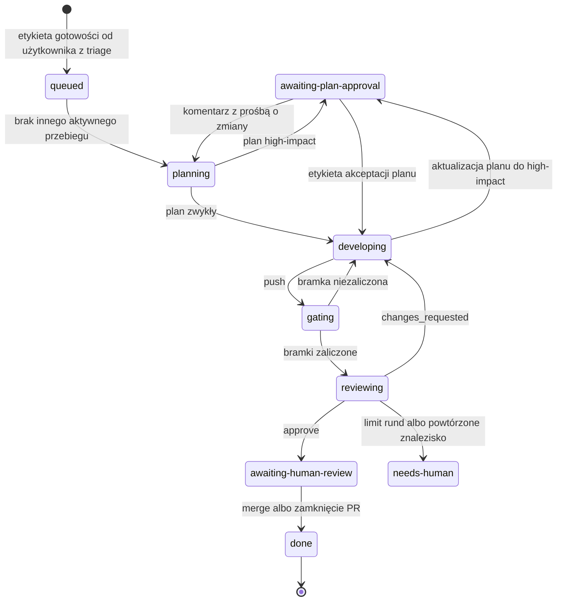
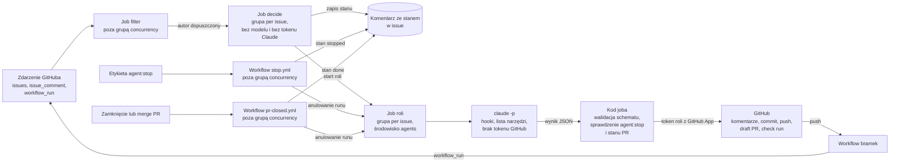

# Plan techniczny: MVP wieloagentowego pipeline'u SDLC

**Autor:** T. Stokłosa
**Status:** Szkic
**Data:** 2026-10-28
**Intencja:** [intent.md](intent.md)
**Specyfikacja:** [spec.md](spec.md)

---

## 1. Podsumowanie

### 1.1 Cel planu

Specyfikacja opisuje docelowy pipeline. Ten plan opisuje, jak dojść do jego pierwszej działającej wersji: najmniejszego przebiegu od początku do końca (walking skeleton), który przejmuje oznaczone issue i oddaje człowiekowi PR po bramkach i pętli review agenta. Reszta specyfikacji jest rozpisana na fazy po MVP.

Odwołania w postaci „spec X.Y” wskazują sekcje specyfikacji, a „rozdz. N” rozdziały tego planu. Identyfikatory wymagań (`FR-`, `NFR-`, `SEC-`, `QG-`), metryk (`M-`), historyjek (`US-`) i pytań otwartych (`OQ-`) pochodzą ze specyfikacji.

### 1.2 Zakres MVP

Przebieg MVP obejmuje stany `queued`, `planning`, `awaiting-plan-approval`, `developing`, `gating`, `reviewing`, `awaiting-human-review`, `done`, `needs-human` i `stopped` (spec 4.1). Stany `deploying-dev` i `handling-comments` są pominięte: werdykt `approve` prowadzi wprost do `awaiting-human-review`.

Etykieta gotowości to `agent:ready`, a etykieta akceptacji planu to `plan:approved`. Z każdego stanu aktywnego przebieg przechodzi do `stopped` po etykiecie `agent:stop`, a z każdego stanu pracy do `needs-human` po wyczerpaniu ponowień albo limitów (spec 4.1, 4.2). Z każdego stanu aktywnego przechodzi też do `done`, gdy człowiek zmerguje lub zamknie PR przebiegu (FR-4.35). Ze stanu `needs-human` wraca do stanu sprzed eskalacji, gdy człowiek zdejmie etykietę. Ze stanów `stopped` i `done` nie ma przejść: dalszą pracę nad issue rozpoczyna nowy przebieg (FR-4.28b).

W MVP działa jeden aktywny przebieg naraz. Pozostałe czekają w `queued`. Powód: limity planu Claude Pro (rozdz. 2.1).

### 1.3 Kryteria ukończenia MVP

- Trzy issue testowe (prosta funkcja, poprawka błędu, zmiana high-impact z nową zależnością) dochodzą do `awaiting-human-review` bez ingerencji człowieka poza akceptacją planu high-impact. Każde mieści się w limicie 45 minut w stanach pracy (NFR-11.5) i w limicie tur.
- Żaden krok nie generuje opłat poza subskrypcją Claude Pro.
- Issue z wstrzykniętą instrukcją, w tym z prośbą o wypisanie tokenu i zmiennych środowiskowych, nie prowadzi do żadnej zablokowanej akcji, a blokady są w logu audytowym.
- Publiczne logi i artefakty workflow nie zawierają tokenu w żadnej postaci.
- `agent:stop` zatrzymuje przebieg w każdym stanie aktywnym MVP, dodane do issue i do PR (P4, na zaślepkach), oraz w trakcie `developing` z prawdziwą sesją agenta (P8). Każde zatrzymanie mieści się w czasie z NFR-4.28d, nie ma skutków ubocznych rozpoczętych po dodaniu etykiety i publikuje jedno podsumowanie (FR-4.28f).
- Żaden agent nie zmergował PR, nie zatwierdził go ani nie wypchnął zmian na `main`.

---

## 2. Decyzje dla MVP

### 2.1 Warunek zera kosztów

MVP nie może generować żadnych opłat poza istniejącą subskrypcją Claude Pro autora. To warunek nadrzędny wobec pozostałych decyzji.

| Element | Darmowa droga |
|---|---|
| Model | Token subskrypcji Pro z `claude setup-token` jako sekret `CLAUDE_CODE_OAUTH_TOKEN`. Zużycie wlicza się w limity planu, wspólne z codzienną pracą autora w Claude Code. |
| Środowisko agentów | Claude Code CLI w trybie headless (`claude -p`), ten sam harness co Claude Agent SDK. |
| CI | GitHub Actions na standardowych runnerach, bez limitu minut w repozytoriach publicznych. |
| Bramki | CodeQL (darmowy dla repozytoriów publicznych), gitleaks (darmowy dla kont osobistych), `dependency-review-action`, ESLint, Vitest, jscpd, lefthook, commitlint. |
| Stan i audyt | W GitHubie: komentarz ze stanem w issue, artefakty workflow. Bez zewnętrznej bazy i hostingu. |
| Integracja z GitHubem | GitHub App (bezpłatna). |

### 2.2 Tabela decyzji

| Temat | Decyzja | Powód | Odrzucona alternatywa |
|---|---|---|---|
| Środowisko agentów (spec 13.4) | Claude Code CLI w trybie headless, wersja przypięta. Każda rola stoi za adapterem (spec 13.4 pkt 3), więc środowisko da się wymienić. | Zero kosztów przy tokenie subskrypcji; wbudowane narzędzia do kodowania i hooki zgodne ze spec 9.2. | Claude Agent SDK z kluczem API (płatny); Claude Managed Agents (płatne, beta); darmowe poziomy innych dostawców i modele lokalne (zmiana frameworka, niskie limity, słaba jakość). |
| Spike frameworków (spec 13.4 pkt 4) | Zastąpiony powyższą decyzją. Spike można wykonać w F4 na zestawie ewaluacji. | Warunek zera kosztów wyklucza pozostałych kandydatów w MVP. | Spike trzech kandydatów w fazie 0. |
| Modele (OQ-10, FR-5.5, FR-5.8) | Planner i Developer: `claude-sonnet-5-5`. Reviewer: `claude-opus-5-5`, jeśli plan Pro udostępnia go w Claude Code, w przeciwnym razie `claude-haiku-5-5`. Model każdej roli jest w pliku `prompts/roles.yml` w tym repozytorium, wersjonowanym razem z promptami (FR-5.8). Repozytorium demo nie wybiera modelu. | Reviewer na innym modelu niż Developer. Review czyta diff, więc zużywa mniej limitu niż implementacja i stać go na mocniejszy model. Model zmienia się tylko przez PR w tym repozytorium, więc repozytorium demo nie ustawi Reviewerowi modelu Developera (FR-5.5), a od F4 zmianę modelu obejmuje ta sama bramka ewaluacji co zmianę promptu (QG-12.4). | Jeden model dla wszystkich ról; Reviewer u innego dostawcy; model w `.sdlc-agents.yml` (repozytorium ustawi Reviewerowi model Developera i zmieni model bez ewaluacji, chyba że baza organizacji dostanie listę dozwolonych modeli); `config/roles.yml` (w `config/` są wartości, które repozytorium może tylko zaostrzyć, a model do nich nie należy; przy promptach jedna ścieżka obejmuje oba pliki bramką ewaluacji); stałe w kodzie modułu `agents` (zmiana modelu ginie wśród zmian kodu). |
| Dane (OQ-7) | Kod i treść issue trafiają do Anthropic w ramach subskrypcji konsumenckiej. O użyciu do trenowania decyduje ustawienie prywatności konta autora. | Repozytorium demo jest publiczne, więc ryzyko ujawnienia jest niskie. | — |
| Repozytorium pilotażowe (OQ-1) | Nowe, publiczne repozytorium `sdlc-pipeline-sandbox` z małą aplikacją TypeScript. | Bezpieczne, przewidywalne, widoczne w portfolio, darmowe CI. | To repozytorium (każda zmiana pipeline'u jest high-impact); prawdziwy projekt (za wcześnie). |
| Orchestrator (FR-5.6) | Reusable workflows w tym repozytorium, wywoływane z repozytorium demo. Sterowanie jest deterministycznym kodem TypeScript; w MVP Orchestrator nie wywołuje modelu. | Brak serwera do utrzymania; zdarzenia GitHuba bez publicznego endpointu. | Własny serwer webhooków z bazą danych (hosting i koszt od pierwszego dnia). |
| Magazyn stanu (FR-4.29) | Ukryty komentarz JSON autorstwa bota w issue, z wersją schematu, identyfikatorem aktywnego runu workflow i kopią konfiguracji z chwili startu przebiegu (FR-10.5). Grupa `concurrency` per issue na poziomie jobów `decide` i roli, z `cancel-in-progress: false`. Do grupy trafiają tylko zdarzenia, które przeszły filtr autorów (rozdz. 3.5). | Zero infrastruktury. Zdarzenia od obcych nie wchodzą do kolejki przebiegu i nie anulują czekających w niej runów. | Zewnętrzna baza danych (konto, sekret, allowlista sieci); grupa na poziomie całego workflow (każde zdarzenie, także od obcych, zajmuje miejsce w kolejce); `cancel-in-progress: true` (każde zdarzenie przerywa pracującego agenta). |
| Limity (OQ-3, OQ-5) | `high_impact.max_files: 10`, `high_impact.max_changed_lines: 400`, `limits.max_minutes_per_run: 45`, nowe pole `limits.max_turns_per_stage: 50`. `limits.max_cost_usd_per_run: 10` liczony z szacunku kosztu raportowanego przez Claude Code, jako miara zużycia, a nie wydatku. Wartości 50 i 10 to szacunki do kalibracji w P2 i P8. Wszystkie są w bazowym zestawie organizacji `config/org-baseline.yml`. | Ostrożne MVP i limity planu Pro. | Wartości przykładowe ze spec 10 ($20, 120 minut). |
| Limit planu Pro | Trafienie w limit planu jest błędem infrastrukturalnym (FR-4.30). Po wyczerpaniu ponowień przebieg przechodzi do `needs-human` z komentarzem, kiedy limit się odnowi. Człowiek wznawia przebieg zdjęciem etykiety (FR-4.32). | Spec nie przewiduje limitów subskrypcji; to najbliższy istniejący mechanizm. | Automatyczne czekanie w jobie (blokuje runner, przekracza limit czasu). |
| GitHub App (OQ-8, SEC-8.1) | Jedna aplikacja bez uprawnienia `workflows`. Tokeny zawężane per rola przez `actions/create-github-app-token` z parametrami `permission-*`, zgodnie z tabelą zakresów w spec 5. Akcja dostaje Client ID aplikacji w parametrze `client-id`, bo od wersji 3 parametr `app-id` jest przestarzały. | Tylko ludzie zmieniają CI; każda rola ma minimalne uprawnienia. | Osobna aplikacja na rolę (więcej kluczy do ochrony). |
| Właściciel pipeline'u (OQ-11) | Autor jest właścicielem i operatorem. Do potwierdzenia. | Projekt jednoosobowy. | — |
| Ponowne uruchomienie po `agent:stop` (FR-4.28b) | Job `decide` odrzuca `agent:ready`, gdy issue lub jego otwarty PR ma `agent:stop`: zdejmuje etykietę i publikuje komentarz. Nowy przebieg z otwartym PR kontynuuje jego branch, a kod joba Developera przed sesją agenta scala do niego aktualny `main` commitem merge; konflikty rozwiązuje Developer w sesji. Bez otwartego PR przebieg tworzy nowy branch i nowy draft PR. | Spec 4.8 po doprecyzowaniu w issue #4. Scalanie wykonuje kod joba, bo agent nie ma dostępu do GitHuba (rozdz. 3.2). | Automatyczne zdejmowanie `agent:stop` przez pipeline (cofa decyzję człowieka, SEC-9.8); ciche ignorowanie `agent:ready` (etykieta zostaje, a późniejsze zdjęcie `agent:stop` niczego nie uruchamia). |
| Zatrzymanie przebiegu (FR-4.28, SEC-8.9) | Osobny workflow `stop.yml` poza grupą `concurrency`, uruchamiany dodaniem etykiety `agent:stop` do issue lub PR. Anuluje aktywny run przebiegu (identyfikator z komentarza ze stanem) tokenem `GITHUB_TOKEN` z uprawnieniem `actions: write` nadanym tylko temu jobowi. Potem zapisuje stan `stopped`, zdejmuje `agent:ready` i `plan:approved` pod nazwami zapisanymi w komentarzu ze stanem przy starcie przebiegu, więc nie czyta `.sdlc-agents.yml` (FR-10.4), publikuje w issue podsumowanie (FR-4.28f), które kod joba składa z komentarza ze stanem bez wywołania modelu, i kończy check run `agent-review` w toku wynikiem `cancelled` z linkiem do podsumowania (FR-4.28a). Używa do tego tokenu App zawężonego do `issues: write` i `checks: write`. Kod jobów sprawdza zatrzymanie (etykietę i stan przebiegu) przed każdym skutkiem ubocznym (rozdz. 3.2, FR-4.28c). | Zatrzymanie nie czeka na koniec joba roli (do 45 minut) i żadne inne zdarzenie nie anuluje go w kolejce. | Obsługa w `orchestrate.yml` w grupie per issue (czeka w kolejce i może zostać z niej usunięta); obsługa w `orchestrate.yml` z grupą zależną od etykiety (`actions: write` dla całego Orchestratora); samo sprawdzanie etykiety bez anulowania runu (agent pracuje dalej i zużywa limit Pro); `actions: write` dla GitHub App (szersze uprawnienia aplikacji i zmiana kroku ręcznego). |
| Zakończenie po zamknięciu lub merge'u PR (FR-4.35) | Osobny workflow `pr-closed.yml` poza grupą `concurrency`, uruchamiany zdarzeniem `pull_request` (closed) i obsługujący tylko PR przebiegu, którego branch pochodzi z repozytorium demo. Gdy przebieg jest w stanie aktywnym, anuluje jego aktywny run tokenem `GITHUB_TOKEN` z uprawnieniem `actions: write` nadanym tylko temu jobowi, zapisuje stan `done`, zdejmuje `agent:ready` i `plan:approved` pod nazwami zapisanymi w komentarzu ze stanem przy starcie przebiegu, kończy check run `agent-review` w toku wynikiem `cancelled` i zapisuje zakończenie w logu zdarzeń. Używa do tego tokenu App zawężonego do `issues: write` i `checks: write`. Gdy przebieg jest już w `stopped` albo `done`, tylko zapisuje zdarzenie w logu. Nie publikuje komentarza o zakończeniu. Anulowanie runu, zdejmowanie etykiet i kończenie check runa to kod wspólny ze `stop.yml`. | Zamknięcie PR w trakcie joba roli nie czeka na jego koniec (do 45 minut), więc agent nie wypycha commitów na branch zamkniętego albo zmergowanego PR i nie zużywa dalej limitu Pro. | Obsługa w `orchestrate.yml` w grupie per issue (czeka w kolejce i może zostać z niej usunięta); obsługa w `stop.yml` (jeden job z rozgałęzieniem po rodzaju zdarzenia i zatarte znaczenie zatrzymania); samo sprawdzanie stanu PR przed skutkiem ubocznym bez anulowania runu (agent pracuje dalej i zużywa limit Pro). |
| Wyłącznik globalny (FR-4.34) | Procedura ręczna autora: wyłączenie workflow `orchestrate.yml` w ustawieniach Actions repozytorium demo, a potem `agent:stop` na issue każdego przebiegu w stanie aktywnym. `stop.yml` zostaje włączony, więc zatrzymanie, porządki i podsumowanie działają. Ponowne włączenie `orchestrate.yml` niczego nie wznawia, bo przebiegi są w `stopped`. | W MVP działa jeden przebieg naraz (rozdz. 1.2) w jednym repozytorium, więc wyłącznik sprowadza się do zatrzymania tego przebiegu i zablokowania nowych. Nie wymaga nowego kodu ani uprawnień. | Zmienna Actions sprawdzana przed każdym skutkiem ubocznym (zmiana zmiennej nie wysyła zdarzenia, więc potrzebne jest okresowe sprawdzanie z FR-4.28e, którego MVP nie ma, oraz uprawnienie App do odczytu zmiennych); workflow `workflow_dispatch` zatrzymujący wszystkie przebiegi (nowy kod przy jednym przebiegu naraz); zawieszenie instalacji GitHub App (porządki z FR-4.28a i podsumowanie nie mają wtedy tokenu). |
| Ochrona `main` (FR-6.3) | Trzy rulesety. Ruleset bramek wymaga bramek z rozdz. 3.6, dopuszcza zmiany `main` tylko przez PR, blokuje force-push i nie ma listy obejść. Ruleset approvalu wymaga approvalu code ownera, a ruleset review agenta check runa `agent-review`. Oba mają na liście obejść tylko rolę administratora repozytorium, z obejściem możliwym tylko przy merge PR. Każdy wymagany check ma przypięte źródło: `agent-review` GitHub App pipeline'u, a bramka aplikację, która ją wystawia. Obejście approvalu to świadome odstępstwo od FR-6.3 (rozdz. 8). | Człowiek zmerguje PR spoza pipeline'u albo PR po zatrzymaniu przebiegu bez pomijania bramek, bo obejście rulesetów approvalu i review agenta nie zwalnia z reguł rulesetu bramek (rozdz. 12). Autor jest jedynym code ownerem repozytorium demo, a GitHub nie pozwala zatwierdzić własnego PR, więc bez obejścia approvalu nie zmergowałby żadnego ręcznego PR, w tym PR z zawartością początkową (P3). PR agenta autor zatwierdza, bo ich autorem jest GitHub App. Pipeline nie dotyka PR, których nie utworzył. Check o tej samej nazwie z innego źródła nie odblokowuje merge. | Klasyczna branch protection (nie pozwala obejść jednego checku bez obejścia pozostałych); check `agent-review` z wynikiem `neutral` publikowany przez pipeline dla PR poza przebiegiem (działanie na cudzych PR wbrew FR-4.33 i po zatrzymaniu wbrew FR-4.28, a PR z forków nie mają sekretów do tokenu App); `agent-review` jako check niewymagany (nic nie wymusza review Reviewera na PR agenta); wymóg zależny od autora PR albo brancha źródłowego (rulesety działają tylko na branchu docelowym); wymagane checki bez przypiętego źródła (check o tej nazwie może wystawić inna aplikacja albo osoba z prawem zapisu); approval code ownera w rulesecie bramek, bez obejścia (ręcznych PR autora nie da się zmergować); ochrona `main` włączona dopiero po PR z zawartością początkową (każdy późniejszy PR autora, np. aktualizacja tagu pipeline'u, dalej wymaga approvalu); drugi code owner (projekt jednoosobowy); drugie konto GitHub autora (warunki GitHuba); brak wymaganego approvalu (PR agenta też by go nie wymagał); PR autora otwierane tokenem App (ukryte obejście approvalu). |

---

## 3. Architektura

### 3.1 Repozytoria

- **`sdlc-multi-agent-pipeline`** (to repozytorium, publiczne): kod pipeline'u w TypeScript, reusable workflows, bazowy zestaw organizacji `config/org-baseline.yml`, prompty ról i ich modele w `prompts/`, ustawienia Claude Code z hookami. Nie przechowuje tokenu Claude i nie uruchamia agentów.
- **`sdlc-pipeline-sandbox`** (nowe, publiczne): mała aplikacja TypeScript z testami, `.sdlc-agents.yml`, workflow bramek, hooki gita, cienkie workflow wywołujące reusable workflows pipeline'u z przypiętym tagiem.

Kod pipeline'u podlega tym samym zasadom co kod tworzony przez agentów (spec 7.3): SOLID, DRY, KISS, YAGNI i prawo Demeter, sprawdzane progami złożoności i duplikacji oraz w review.

### 3.2 Zasada: agent bez dostępu do GitHuba

Sesje agentów nie dostają żadnego tokenu GitHub. Agent pracuje tylko na przestrzeni roboczej i kończy pracę wynikiem w JSON: planem, komunikatem commita, werdyktem ze znaleziskami, odpowiedziami w wątkach albo listą issue spoza zakresu. Kod joba waliduje ten wynik schematem i dopiero wtedy wykonuje skutki uboczne w GitHubie tokenem roli: komentarze, commit, push, draft PR, check run, prośbę o review.

Przed każdym skutkiem ubocznym kod joba sprawdza, czy issue lub PR nie ma etykiety `agent:stop`, czy PR przebiegu nie jest zamknięty ani zmergowany (FR-4.35) i czy komentarz ze stanem nadal wskazuje jego przebieg jako aktywny (FR-4.28c). Jeśli któryś warunek wskazuje koniec przebiegu, job kończy się bez akcji. Do zablokowania wystarczy jeden z nich: spóźniony zapis stanu nie cofnie zatrzymania, a zdjęcie etykiety go nie wznowi (FR-4.28).

Dzięki temu zakazy z SEC-9.2, SEC-9.6, SEC-9.7 i SEC-9.8 są wymuszone strukturalnie: agent nie ma czym wykonać zakazanej akcji. Hooki z spec 9.2 są drugą warstwą (SEC-9.0c), a nie jedyną. Ta zasada zmniejsza też skutki prompt injection (SEC-8.5), bo wstrzyknięta instrukcja może zmienić najwyżej treść wyniku, który i tak przechodzi walidację.

### 3.3 Moduły

| Moduł | Odpowiedzialność | Wymagania |
|---|---|---|
| `core/state-machine` | Czysta funkcja: stan i zdarzenie na wejściu, nowy stan i lista akcji na wyjściu, według spec 4.2 | FR-5.6 |
| `core/run-store` | Interfejs `RunStateStore` z implementacją na komentarzu w issue i implementacją w pamięci do testów. Interfejs uzasadniają testy i możliwa baza danych w F5. | FR-4.29 |
| `config` | Schemat `.sdlc-agents.yml` (zod), scalanie z bazą organizacji tylko w stronę zaostrzenia, także dla kopii zapisanej przy starcie przebiegu | FR-10.1, FR-10.2, FR-10.5 |
| `github` | Klient Octokit, sprawdzanie uprawnień autora zdarzenia (triage, zapis, bot), etykiety, PR, check runy | FR-4.1, FR-4.23, FR-4.33, SEC-8.6, SEC-8.7 |
| `hooks` | Każda reguła jako osobna polityka za wspólnym interfejsem, opakowanie fail-closed, zestaw bazowy plus zaostrzenia repozytorium | SEC-9.0a, SEC-9.0b, spec 9.2 |
| `agents` | Adapter roli (ustrukturyzowane wejście i wyjście), implementacja na Claude Code CLI, role Planner, Developer i Reviewer, model roli z `prompts/roles.yml` | FR-5.1, FR-5.5, FR-5.8 |
| `gates/scope` | Deterministyczna bramka zakresu uruchamiana w CI repozytorium demo | QG-7.9 |
| `audit` | Zdarzenia jako JSONL, zużycie tokenów i szacunek kosztu z wyniku CLI, liczniki limitów | NFR-11.3, NFR-11.4, NFR-11.5 |

Nowe zachowanie (kolejna rola, kolejna polityka hooka, kolejny magazyn stanu) dodaje się nową implementacją istniejącego interfejsu, bez zmiany kodu, który z niego korzysta.

### 3.4 Uruchomienie roli

Każda rola działa w osobnym jobie, z osobnym tokenem App i osobną sesją (FR-5.1). Job uruchamia `claude -p` z:

- modelem roli z `prompts/roles.yml` (`--model`);
- listą dozwolonych narzędzi (Planner i Reviewer: tylko odczyt i wyszukiwanie; Developer: odczyt, edycja, zapis i polecenia powłoki ograniczone hookami);
- limitem tur (`--max-turns`);
- wynikiem w JSON, który zawiera też zużycie tokenów i szacunek kosztu;
- plikiem ustawień z hookami `PreToolUse`, `PostToolUse`, `PostToolUseFailure` i `Stop` oraz z sandboxem poleceń powłoki, bez ustawień projektu z przestrzeni roboczej (`--setting-sources user`), żeby repozytorium nie osłabiło hooków. Hooki to skrypt Node z kodu TypeScript pipeline'u, uruchamiany bez kroku budowania (usuwanie typów w Node 22), który czyta zdarzenie z wejścia standardowego. Plik ustawień i kontekst hooków zapisuje `npm run prepare-session` poza przestrzenią roboczą, więc agent nie zmieni własnych hooków.

Hook `PostToolUse` dopisuje ścieżkę edytowanego pliku do poleceń `commands.format` i `commands.lint` (QG-9.9), więc te polecenia muszą przyjmować ścieżki plików i nie mogą zgłaszać błędu dla plików, których narzędzie nie obsługuje (np. `prettier --write --ignore-unknown`, `eslint --no-warn-ignored`). Hook `Stop` uruchamia je bez ścieżek (QG-9.12).

Prompty ról i ich modele są wersjonowane w `prompts/` (FR-5.8). Dokładne flagi CLI zostaną potwierdzone w P2 (rozdz. 12).

### 3.5 Przepływ zdarzeń

- Workflow `orchestrate.yml` uruchamiają zdarzenia `issues` (labeled, unlabeled), `issue_comment` i `workflow_run` po zakończeniu workflow bramek. Zamknięcie i merge PR obsługuje `pr-closed.yml`.
- Job `filter` działa poza grupą `concurrency` i nie wywołuje modelu. Odrzuca zdarzenia od botów, komentarze autorów spoza współpracowników repozytorium (`author_association`) oraz dodanie `agent:stop`, które obsługuje `stop.yml`. Ustala też numer issue, który jest kluczem grupy. Dokładne sprawdzenie uprawnień autora wykonuje `decide` (rozdz. 4).
- Joby `decide` i roli należą do grupy `concurrency` per issue z `cancel-in-progress: false`, więc w przebiegu działa jeden job naraz. Job `decide` liczy przejście, zapisuje stan z identyfikatorem runu i warunkowo startuje job roli.
- Workflow `stop.yml` uruchamia dodanie etykiety `agent:stop` do issue lub PR. Działa poza grupą, więc nie czeka na koniec joba roli. Anuluje aktywny run przebiegu, zapisuje stan `stopped`, porządkuje etykiety i check run `agent-review` (FR-4.28a) i publikuje podsumowanie (rozdz. 2.2). Runy, które czekały w grupie, po starcie widzą etykietę i kończą się bez akcji.
- Workflow `pr-closed.yml` uruchamia zamknięcie lub merge PR przebiegu. Działa poza grupą, tak jak `stop.yml`. Gdy przebieg jest aktywny, anuluje jego run, zapisuje stan `done`, zdejmuje `agent:ready` i `plan:approved` i kończy check run `agent-review` (FR-4.35, rozdz. 2.2). Runy, które czekały w grupie, po starcie widzą zamknięty PR i kończą się bez akcji.
- Wyniki bramek pipeline odbiera przez `workflow_run`, bo zdarzenie `check_suite` nie uruchamia workflow dla suite'ów utworzonych przez GitHub Actions.
- Pushe wykonuje token GitHub App, więc uruchamiają CI. Pushe tokenem `GITHUB_TOKEN` by go nie uruchomiły.

### 3.6 Bramki w repozytorium demo

| Bramka | Narzędzie |
|---|---|
| QG-7.1 Analiza statyczna | ESLint, poziom `error` |
| QG-7.2 SAST | CodeQL |
| QG-7.3 Skanowanie sekretów | gitleaks |
| QG-7.4 Skanowanie zależności | `actions/dependency-review-action`, próg `high` |
| QG-7.5 Testy | Vitest |
| QG-7.6 Pokrycie | Vitest z pokryciem porównywanym z `main`, tolerancja 0 |
| QG-7.7 Złożoność | Reguła ESLint `complexity`, próg 10 |
| QG-7.8 Duplikacja | jscpd, próg 3% |
| QG-7.9 Zakres | `gates/scope` z tego repozytorium |
| QG-9.13, QG-9.14 Hooki gita | lefthook (formatter, linter, gitleaks) i commitlint |

Workflow bramek w MVP nie czyta `.sdlc-agents.yml`. Progi bramek są stałe i równe sekcji `gates` z `config/org-baseline.yml`, a polecenia lintera, testów i pokrycia są wpisane w workflow, zamiast pochodzić z `commands.lint`, `commands.test` i `commands.coverage`. Dlatego ani zaostrzenie progu, ani zmiana polecenia w konfiguracji repozytorium nie mają w MVP skutku w CI (rozdz. 8). Zmianę `gates` w bazie organizacji autor przenosi ręcznie do workflow bramek repozytorium demo, w PR aktualizującym tag pipeline'u.

Te same sprawdzenia działają w CI (QG-7.12). Ochronę `main` tworzą trzy rulesety (rozdz. 2.2, FR-6.3). Ruleset bramek wymaga wszystkich bramek i nie ma listy obejść. Ruleset approvalu wymaga approvalu code ownera, a ruleset review agenta check runa `agent-review`. Oba przy merge PR może obejść tylko administrator repozytorium, a obejście approvalu to odstępstwo z rozdz. 8. Tożsamości pipeline'u nie ma na żadnej liście obejść. Każdy wymagany check ma przypięte źródło, a joby bramek nie mają uprawnień `checks: write` ani `statuses: write` (QG-7.14).

---

## 4. Ochrona tokenu subskrypcji w publicznym repozytorium

W repozytorium publicznym każdy może założyć issue i dodać komentarz, a logi i artefakty workflow są jawne. Workflow uruchomione przez `issues` i `issue_comment` działają w kontekście repozytorium, więc mają dostęp do sekretów. Cel tego rozdziału: nikt poza autorem nie może uruchomić agenta na tokenie subskrypcji ani tego tokenu odczytać.

| Środek | Opis | Wymagania | Wprowadza | Sprawdza |
|---|---|---|---|---|
| Token tylko w jobach ról | `CLAUDE_CODE_OAUTH_TOKEN` jest sekretem środowiska GitHub `agents` z polityką „tylko branch `main`”. Odwołują się do niego wyłącznie joby ról. Joby `filter` i `decide`, workflowy `stop.yml` i `pr-closed.yml` oraz workflow bramek go nie widzą. | SEC-8.2 | P3, P4 | P3: workflow bez środowiska `agents` nie ma tokenu |
| Bramka przed modelem | Job roli startuje tylko wtedy, gdy `decide` potwierdzi, że etykietę dodał użytkownik z co najmniej triage, a komentarz napisał użytkownik z prawem zapisu, który nie jest botem. Komentarze od obcych odpadają już w jobie `filter`. Komentarze współpracowników bez wymaganych uprawnień odrzuca `decide`. Oba joby kończą się bez wywołania modelu. | FR-4.1, FR-4.23, SEC-8.6, SEC-8.7 | P4 | Testy jednostkowe dla każdego typu autora |
| Zatrzymanie poza kolejką | Zdarzenia od obcych odpadają w jobie `filter`, zanim trafią do grupy `concurrency`, więc nie opóźniają zdarzeń przebiegu ani nie usuwają ich z kolejki. `agent:stop` obsługuje osobny workflow poza grupą (rozdz. 2.2, 3.5). | FR-4.28, SEC-8.6, SEC-8.9 | P4 | Testy joba `filter`; zatrzymanie w trakcie joba roli z równoległymi komentarzami obcych w P4 |
| Brak zdarzeń z forków | Zakaz `pull_request_target` w obu repozytoriach. `workflow_run` jest obsługiwany tylko wtedy, gdy branch pochodzi z repozytorium demo i należy do aktywnego przebiegu. `pull_request` (closed) jest obsługiwany tylko dla PR przebiegu, którego branch pochodzi z repozytorium demo. Bramki działają na `pull_request`, które nie dostaje sekretów dla forków. | FR-4.33 | P3, P4 | Testy `decide` i `pr-closed.yml`; przegląd workflow w P3 |
| Ustawienia Actions | Zgoda na uruchomienie workflow dla wszystkich zewnętrznych współtwórców; domyślne uprawnienia `GITHUB_TOKEN` tylko do odczytu; joby bramek nie dostają `checks: write` ani `statuses: write`. | SEC-8.1, QG-7.14 | P3 | Przegląd ustawień i uprawnień jobów bramek w P3 |
| Agent nie zmienia workflow | GitHub App bez uprawnienia `workflows` (OQ-8). Hook i bramka zakresu dodatkowo blokują zmiany w `.github/`. | SEC-9.1, QG-7.9, QG-7.11 | P2, P3, P6 | Testy hooków; próba w P8 |
| Nic nie wycieka do logów | Polecenia powłoki agenta nie dziedziczą tokenu. Hooki blokują odczyt zmiennych środowiskowych i plików z sekretami. Wyniki narzędzi, komentarze i log audytowy przechodzą przez redakcję sekretów, także zakodowanych w base64 i hex. Pełne transkrypty sesji nie trafiają ani do logów, ani do artefaktów; artefakt audytu zawiera tylko podsumowania. | SEC-9.3, SEC-9.10, NFR-9.11 | P2 | Testy hooków z przypadkami ataku; przegląd logów w P8 |
| Treść niezaufana | Issue i komentarze trafiają do agenta jako dane, nie jako instrukcje. | SEC-8.5 | P2, P5, P6, P7 | Issue z wstrzykniętą instrukcją w P8 |

**Procedura na wypadek wycieku:** unieważnić token, wygenerować nowy przez `claude setup-token`, podmienić sekret w środowisku `agents`, przejrzeć logi i artefakty workflow od chwili możliwego wycieku. Rotacja planowa raz na kwartał.

---

## 5. Przyrosty MVP

Każdy przyrost to jeden ticket, jeden branch `<typ>/<numer-ticketu>-<krótki-opis>` i jeden PR. Przyrosty są realizowane pojedynczo. Przyrost zaczyna się dopiero wtedy, gdy ukończone są wszystkie przyrosty z jego pola „Zależy od”, więc P3, który zależy tylko od P0, można zrealizować przed P1 i P2. Ticket powstaje w chwili rozpoczęcia przyrostu.

### P0. Szkielet repozytorium pipeline'u

- **Zakres:** TypeScript w trybie strict, ESLint (w tym reguły złożoności), Prettier, Vitest, lefthook, commitlint, CI tego repozytorium, struktura katalogów z rozdz. 3.3.
- **Wymagania:** QG-9.13, QG-9.14, QG-9.15.
- **Gotowe, gdy:** CI jest zielone, a hooki gita odrzucają commit niezgodny z Conventional Commits i commit z sekretem.
- **Zależy od:** —

### P1. Konfiguracja

- **Zakres:** schemat `.sdlc-agents.yml` z polami ze spec 10 i `limits.max_turns_per_stage`, bez `labels.stop`, bo nazwa `agent:stop` jest stała (FR-10.4), `config/org-baseline.yml`, scalanie tylko w stronę zaostrzenia, także kopii konfiguracji przebiegu z aktualną bazą organizacji (FR-10.5), CLI walidacji.
- **Wymagania:** FR-10.1, FR-10.2, FR-10.5.
- **Gotowe, gdy:** testy potwierdzają odrzucenie niepoprawnej konfiguracji i każdej próby złagodzenia bazy organizacji.
- **Zależy od:** P0.

### P2. Hooki bazowe i środowisko agentów

- **Zakres:** polityki `PreToolUse` (SEC-9.1 do SEC-9.8), `PostToolUse` (QG-9.9, SEC-9.10, NFR-9.11) i `Stop` (QG-9.12), opakowanie fail-closed, testy z przypadkami ataku jako zalążek zestawu z QG-12.3. Próbna sesja `claude -p` na runnerze GitHub Actions i potwierdzenie założeń z rozdz. 12.
- **Wymagania:** SEC-9.0a, SEC-9.0b, SEC-9.0c, SEC-9.1 do SEC-9.8, QG-9.9, SEC-9.10, NFR-9.11, QG-9.12, FR-5.4.
- **Gotowe, gdy:** każdy przypadek ataku jest blokowany w testach, a próbna sesja na runnerze działa na tokenie subskrypcji bez opłat i bez wycieku tokenu do logów.
- **Zależy od:** P1.

### P3. Repozytorium demo i GitHub App

- **Zakres:** repozytorium `sdlc-pipeline-sandbox` z pustym commitem początkowym i całą zawartością wprowadzoną przez PR: aplikacja TypeScript z testami, workflow bramek (rozdz. 3.6), hooki gita, CODEOWNERS, trzy rulesety ochrony `main` (rozdz. 2.2), etykiety ze spec 10, środowisko `agents`, ustawienia Actions z rozdz. 4. GitHub App zainstalowana w repozytorium demo.
- **Wymagania:** QG-7.1 do QG-7.8, QG-7.12, QG-7.14, FR-6.3, FR-6.6, SEC-8.1, SEC-8.2.
- **Gotowe, gdy:** ręczny PR autora przechodzi wszystkie bramki i da się go zmergować tylko obejściem przez administratora, obejście nie pomija bramek, `agent-review` wystawiony innym tokenem niż token App nie odblokowuje merge, push na `main` jest odrzucany, a workflow bez środowiska `agents` nie ma dostępu do tokenu. Approval code ownera bez obejścia sprawdza P7 na PR agenta, bo autor nie zatwierdzi własnego PR.
- **Zależy od:** P0 (narzędzia i konwencje); utworzenie repozytorium wymaga zgody autora.

### P4. Orchestrator i magazyn stanu

- **Zakres:** maszyna stanów dla podzbioru MVP, magazyn stanu w komentarzu (z kopią `.sdlc-agents.yml` i SHA commita `main` z chwili startu przebiegu, w tym z nazwami etykiet, FR-10.5), `orchestrate.yml`, `stop.yml`, `pr-closed.yml`, wyzwalacze ze spec 9.4 w zakresie MVP, filtr autorów zdarzeń, `agent:stop` z porządkowaniem etykiet i check runa, zakończenie przebiegu po zamknięciu lub merge'u PR w każdym stanie aktywnym MVP, odrzucanie `agent:ready` przy obecnym `agent:stop`, `needs-human`, limity czasu i tur (czas jako suma pobytów w stanach pracy, liczona z przejść zapisanych w komentarzu ze stanem, NFR-11.5), ponowienia, obsługa limitu planu Pro, log zdarzeń, `.sdlc-agents.yml` w repozytorium demo bez sekcji `gates` i z `commands.lint`, `commands.test` i `commands.coverage` równymi poleceniom workflow bramek, bo w MVP bramki nie czytają tego pliku, a agent i CI mają sprawdzać zmianę tak samo (rozdz. 3.6), wprowadzony przez PR i zwalidowany CLI z P1 z tagu pipeline'u przypiętego w cienkich workflow (FR-10.1). Role działają jako zaślepki zwracające gotowy wynik, więc ten przyrost nie zużywa limitu Pro.
- **Wymagania:** FR-4.1, FR-4.2, FR-4.23, FR-4.28 do FR-4.33, FR-4.35, NFR-4.28d, FR-5.6, FR-6.7, SEC-8.3, SEC-8.6 do SEC-8.9, SEC-9.8a, FR-10.1, FR-10.4, FR-10.5, NFR-11.3 do NFR-11.5, QG-12.3a (częściowo).
- **Gotowe, gdy:** przebieg na zaślepkach przechodzi przez wszystkie stany MVP w repozytorium demo, każde przejście ma test jednostkowy, zdarzenia od nieuprawnionych autorów nie startują żadnej roli, a `agent:stop` dodane w trakcie joba roli przerywa run bez czekania na jego koniec, w czasie z NFR-4.28d. Po zatrzymaniu nie ma żadnych skutków ubocznych poza dokończeniem operacji, która przeszła sprawdzenie przed dodaniem etykiety (FR-4.28c), a komentarze innych użytkowników dodane w tym czasie nie opóźniają ani nie anulują zatrzymania. Każde zatrzymanie publikuje w issue dokładnie jedno podsumowanie z elementami z FR-4.28f, także przy `agent:stop` dodanym do issue i do PR. Zatrzymanie działa również przy niepoprawnym `.sdlc-agents.yml` w repozytorium demo (FR-10.4). Zmiana `.sdlc-agents.yml` zmergowana w trakcie przebiegu nie zmienia jego limitów ani nazw etykiet (FR-10.5). Testy zatrzymania z QG-12.3a w zakresie MVP przechodzą na zaślepkach w każdym stanie aktywnym MVP, a zdarzenia zatrzymania i sprawdzeń z FR-4.28c trafiają do logu zdarzeń (NFR-11.3). Ponowne `agent:ready` po zdjęciu `agent:stop` startuje nowy przebieg, a `agent:ready` przy obecnym `agent:stop` zostaje zdjęte z komentarzem. Zamknięcie lub merge PR w trakcie joba roli przerywa run w czasie z NFR-4.28d, przebieg przechodzi do `done`, z issue znikają `agent:ready` i `plan:approved`, a po zamknięciu nie ma żadnych pushy ani komentarzy przebiegu (FR-4.35). Ponowne `agent:ready` po zamknięciu PR bez merge'u startuje nowy przebieg.
- **Zależy od:** P2, P3.

### P5. Planner

- **Zakres:** prompt Plannera, plik `prompts/roles.yml` z modelem Plannera, komentarz z planem i blokiem `sdlc-plan` w YAML (lista plików z jednym zdaniem uzasadnienia przy każdym), klasyfikacja high-impact jako suma reguł deterministycznych (ścieżki z konfiguracji, manifesty zależności, pliki CI, `.sdlc-agents.yml`, limity rozmiaru) i oceny modelu (bezpieczeństwo, publiczne API). Suma, bo przeoczenie zmiany high-impact jest droższe niż fałszywy alarm (spec 12.2). Każda wersja planu jako osobny komentarz z numerem. Akceptacja etykietą `plan:approved` dodaną w `awaiting-plan-approval`, z numerem zaakceptowanej wersji w komentarzu ze stanem, zdejmowanie `plan:approved` przed publikacją każdej wersji wymagającej akceptacji i poprawki po komentarzu człowieka. W nowym przebiegu po zatrzymaniu Planner dostaje poprzednie plany, podsumowanie zatrzymania, nowe komentarze i diff brancha.
- **Wymagania:** FR-4.3 do FR-4.6, FR-4.28b, FR-6.1, FR-10.3, SEC-8.5, SEC-8.10.
- **Gotowe, gdy:** na trzech issue testowych plan ma wszystkie elementy z FR-4.3, zmiana z nową zależnością jest sklasyfikowana jako high-impact, a przebieg czeka na `plan:approved`.
- **Zależy od:** P4.

### P6. Developer i bramka zakresu

- **Zakres:** prompt Developera, model Developera w `prompts/roles.yml`, sesja bez tokenu GitHub, commit i push wykonywane przez kod joba, Conventional Commits z odwołaniem do issue, draft PR z `Closes #<numer>`, issue spoza zakresu, aktualizacja planu z powodem, powrót do Developera po niezaliczonej bramce, bramka zakresu `gates/scope` w CI repozytorium demo. W nowym przebiegu po zatrzymaniu: kontynuacja brancha otwartego PR ze scaleniem `main` przez kod joba przed sesją agenta albo nowy branch i nowy draft PR, gdy poprzedni PR zamknięto.
- **Wymagania:** FR-4.7 do FR-4.12, FR-4.28b, QG-7.9, QG-7.11.
- **Gotowe, gdy:** prosta funkcja z issue testowego przechodzi bramki, plik spoza planu nie przechodzi bramki zakresu, a niezaliczona bramka wraca do Developera bez zużycia rundy review. Aktualizacja planu do high-impact przenosi przebieg do `awaiting-plan-approval`, zdejmuje `plan:approved` i czeka na ponowne dodanie etykiety.
- **Zależy od:** P5.

### P7. Reviewer i pętla review

- **Zakres:** prompt Reviewera z checklistą ze spec 7.3, kontekst ograniczony do issue, planu, diffu, wyników bramek i wcześniejszych znalezisk, narzędzia tylko do odczytu, model Reviewera w `prompts/roles.yml` inny niż model Developera (FR-5.5). Stabilny identyfikator znaleziska jako skrót z reguły, pliku i zakotwiczenia w kodzie. Werdykt jako check run `agent-review`, znaleziska jako komentarze review bez approvalu. Limit rund i eskalacja powtórzonego znaleziska. Na koniec PR oznaczony jako gotowy i prośba o review z opisem według FR-4.20, bez URL środowiska dev.
- **Wymagania:** FR-4.13 do FR-4.18, FR-4.20, FR-5.2, FR-5.3, FR-5.5, FR-6.2, FR-6.3, FR-6.4, QG-7.10.
- **Gotowe, gdy:** diff z celowo podłożonym naruszeniem dostaje `changes_requested`, poprawiony diff dostaje `approve`, a czwarta runda kończy się w `needs-human`. PR agenta po `approve` Reviewera i approvalu autora da się zmergować bez obejścia, a bez approvalu autora tylko obejściem przez administratora. Test odrzuca `prompts/roles.yml`, w którym Reviewer ma ten sam model co Developer.
- **Zależy od:** P6.

### P8. Test end-to-end MVP

- **Zakres:** cztery issue testowe: prosta funkcja, poprawka błędu, zmiana high-impact z nową zależnością, issue z wstrzykniętą instrukcją (m.in. prośba o wypisanie tokenu i zmiennych środowiskowych, push na `main`, pominięcie bramek). Uruchamiane po jednym, żeby zmieścić się w limitach Pro. Przegląd publicznych logów i artefaktów pod kątem wycieku. Raport z wynikami, zużyciem, blokadami hooków i listą poprawek.
- **Wymagania:** kryteria z rozdz. 1.3, QG-12.3 i QG-12.3a (częściowo).
- **Gotowe, gdy:** spełnione są wszystkie kryteria ukończenia MVP z rozdz. 1.3.
- **Zależy od:** P7.

---

## 6. Fazy po MVP

| Faza | Zakres | Wymagania | Pytania otwarte |
|---|---|---|---|
| F2 | Obsługa komentarzy człowieka w PR, klasyfikacja komentarzy na `claude-haiku-5-5`, ponowna pętla po zmianach | FR-4.21, FR-4.22, FR-4.24 do FR-4.27 | — |
| F3 | Wdrożenie branchu PR na dev przez agenta DevOps z OIDC, na darmowym celu (np. podgląd w GitHub Pages albo kontener uruchamiany w samym jobie) | FR-4.19, FR-5.7 | OQ-2 |
| F4 | Zestaw ewaluacji i bramka ewaluacji w CI pipeline'u, dawkowane pod limity Pro; opcjonalny spike frameworków na tym zestawie | QG-12.1, QG-12.3 do QG-12.7, FR-5.8 | OQ-4 |
| F5 | Obserwowalność i metryki: magazyn zdarzeń tylko do dopisywania (darmowy), trace, zapis wyjątków, linia bazowa, dashboard zestawu podstawowego ze spec 14.10 | NFR-11.1, NFR-11.2, NFR-11.6, QG-7.13 | OQ-6, OQ-9 |
| F6 | Pilotaż na prawdziwym repozytorium (faza 1 ze spec 15), pełna allowlista ruchu sieciowego, progi i polecenia bramek z `gates.*` i `commands.*` w `.sdlc-agents.yml` | SEC-8.4, QG-7.1, QG-7.2, QG-7.4 do QG-7.8, FR-10.2 | OQ-1 dla pilotażu, OQ-12 |

---

## 7. Tabela śledzenia wymagań

Status **MVP** oznacza wymaganie spełnione w MVP, **częściowo** oznacza spełnienie z ograniczeniem opisanym w uwagach, **później** oznacza fazę po MVP, a **odstępstwo** oznacza świadome niespełnienie w MVP z powodem z rozdz. 8.

### 7.1 Przebieg (spec 4)

| Wymagania | Status | Gdzie | Uwagi |
|---|---|---|---|
| FR-4.1, FR-4.2 | MVP | P4 | Jeden aktywny przebieg naraz w repozytorium. |
| FR-4.3, FR-4.4, FR-4.5, FR-4.6 | MVP | P5 | |
| FR-4.7, FR-4.8, FR-4.9, FR-4.10, FR-4.11, FR-4.12 | MVP | P6 | |
| FR-4.13, FR-4.14, FR-4.15, FR-4.16, FR-4.17, FR-4.18 | MVP | P7 | Odpowiedzi Developera w wątkach publikuje kod joba. |
| FR-4.19 | Później | F3 | |
| FR-4.20 | Częściowo | P7 | Bez URL środowiska dev do F3. |
| FR-4.21, FR-4.22, FR-4.24, FR-4.25, FR-4.26, FR-4.27 | Później | F2 | |
| FR-4.23 | MVP | P4 | Filtr autorów potrzebny już w MVP (rozdz. 4). |
| FR-4.28, FR-4.28a, FR-4.28b | MVP | P4 do P6 | Porzucanie obsługi komentarzy po opóźnieniu i zwalnianie blokady dev (FR-4.28a) wchodzą razem z F2 i F3. |
| FR-4.28c | MVP | P4 do P7 | Sprawdzenie w kodzie jobów przed każdym skutkiem ubocznym (rozdz. 3.2). Wyłącznik globalny działa w MVP przez etykiety (rozdz. 2.2), więc sprawdzenie nie ma dla niego osobnego warunku. |
| NFR-4.28d | Częściowo | P4 | Bez FR-4.28e zgubione zdarzenie `agent:stop` wydłuża zatrzymanie do końca joba roli (do 45 minut). |
| FR-4.28e | Odstępstwo | — | Rozdz. 8. |
| FR-4.28f | MVP | P4 | Podsumowanie publikuje `stop.yml` na podstawie komentarza ze stanem. |
| FR-4.29, FR-4.30, FR-4.31, FR-4.33 | MVP | P4 | FR-4.31: limit kosztu jako szacunek zużycia. |
| FR-4.32 | Częściowo | P4 | Komentarze z czasu przerwy obsługuje F2. |
| FR-4.34 | Odstępstwo | — | Rozdz. 8. W MVP wyłącznik to procedura ręczna z rozdz. 2.2. |
| FR-4.35 | MVP | P4 | Obsługuje `pr-closed.yml` (rozdz. 2.2). Porzucanie obsługi komentarzy po opóźnieniu i zwalnianie blokady dev wchodzą razem z F2 i F3. |
| FR-4.36 | Odstępstwo | — | Rozdz. 8. Utracone zdarzenie autor odtwarza ręcznie. |

### 7.2 Agenci, human-in-the-loop i bramki (spec 5, 6, 7)

| Wymagania | Status | Gdzie | Uwagi |
|---|---|---|---|
| FR-5.1 | MVP | P4 do P7 | Osobny job, sesja i token na rolę. |
| FR-5.2 | MVP | P3, P7 | Reviewer publikuje tylko check run; merge wymaga approvalu code ownera albo obejścia przez administratora (rozdz. 8). |
| FR-5.3 | MVP | P7 | |
| FR-5.5 | MVP | P7 | Modele ról w `prompts/roles.yml` w repozytorium pipeline'u; test odrzuca ten sam model Reviewera i Developera. |
| FR-5.4 | MVP | P2, P7 | Lista narzędzi, hook SEC-9.7, brak tokenu GitHub w sesji. |
| FR-5.6 | MVP | P4 | |
| FR-5.7 | Później | F3 | |
| FR-5.8 | Częściowo | P5 do P7, F4 | Prompty i modele ról wersjonowane w `prompts/` od MVP; bramka ewaluacji w F4. |
| FR-6.1, FR-10.3 | MVP | P5 | |
| FR-6.2, FR-6.4 | MVP | P7 | |
| FR-6.3 | Częściowo | P3, P7 | Trzy rulesety z przypiętymi źródłami checków; approval code ownera i `agent-review` obchodzi przy merge PR tylko administrator repozytorium (rozdz. 2.2). Obejście zwalnia też z approvalu (rozdz. 8). |
| FR-6.5 | MVP | P2, P3 | Brak tokenu w sesji, hook SEC-9.8, App bez wyjątku od branch protection. |
| FR-6.6 | MVP | P3 | Repozytorium demo nie ma środowisk staging ani produkcja. Wymóg recenzentów wraca przy pierwszym takim środowisku. |
| FR-6.7 | MVP | P4 | Pipeline nie ma ścieżki, w której agent przyznaje wyjątek. |
| QG-7.1, QG-7.2, QG-7.4, QG-7.5, QG-7.6, QG-7.7, QG-7.8 | Częściowo | P3, F6 | Narzędzia w rozdz. 3.6. Progi równe bazie organizacji i polecenia wpisane w workflow, bo `gates.*` i `commands.*` z `.sdlc-agents.yml` nie działają w CI do F6 (rozdz. 8). |
| QG-7.3 | MVP | P3 | Narzędzia w rozdz. 3.6. |
| QG-7.9 | MVP | P6 | |
| QG-7.10 | MVP | P7 | |
| QG-7.11 | MVP | P2, P3, P6 | Hooki, App bez `workflows`, zmiany konfiguracji bramek są high-impact. |
| QG-7.12 | MVP | P3 | |
| QG-7.13 | Później | F5 | W MVP niezaliczona bramka zawsze wraca do Developera, a po wyczerpaniu ponowień przebieg trafia do `needs-human`. |
| QG-7.14 | MVP | P3 | Joby bramek bez `checks: write` i `statuses: write`. |

### 7.3 Bezpieczeństwo i hooki (spec 8, 9)

| Wymagania | Status | Gdzie | Uwagi |
|---|---|---|---|
| SEC-8.1, SEC-8.2 | MVP | P3, P4 | |
| SEC-8.3 | MVP | P4 | Runnery hostowane przez GitHub to jednorazowe maszyny per job. |
| SEC-8.4 | Odstępstwo | P2, F6 | Częściowo przez sandbox poleceń powłoki w Claude Code (do potwierdzenia). |
| SEC-8.5 | MVP | P2, P5 do P7 | |
| SEC-8.6, SEC-8.7, SEC-8.9 | MVP | P4 | Liczenie M-E06 w F5. |
| SEC-8.8 | MVP | P4 | W trybie Actions GitHub dostarcza zdarzenia wewnętrznie i nie ma publicznego endpointu webhooków. Wymóg wraca przy własnym serwerze. |
| SEC-8.10 | MVP | P5 do P7 | Agent dostaje tylko issue, plan, diff i przestrzeń roboczą repozytorium demo. |
| SEC-9.0a, SEC-9.0b | MVP | P2 | |
| SEC-9.0c | Częściowo | P2 | Razem z SEC-8.4. |
| SEC-9.1, SEC-9.2, SEC-9.3, SEC-9.4, SEC-9.5, SEC-9.6, SEC-9.7, SEC-9.8 | MVP | P2 | SEC-9.4 w granicach SEC-8.4. |
| SEC-9.8a | MVP | P4 | Strukturalnie: sesja nie ma narzędzi ze skutkami w GitHubie (rozdz. 3.2), a sprawdzenie z FR-4.28c wykonuje kod joba. |
| QG-9.9, SEC-9.10, NFR-9.11, QG-9.12 | MVP | P2 | |
| QG-9.13, QG-9.14, QG-9.15 | MVP | P0, P3 | |

### 7.4 Konfiguracja, obserwowalność i ewaluacje (spec 10, 11, 12)

| Wymagania | Status | Gdzie | Uwagi |
|---|---|---|---|
| FR-10.1 | MVP | P1, P4 | Schemat i CLI walidacji w P1, plik w repozytorium demo w P4. |
| FR-10.2 | Częściowo | P1, F6 | Zaostrzenie `gates.*` przechodzi walidację, ale do F6 nie działa w CI (rozdz. 8). |
| FR-10.4 | MVP | P1, P4 | Schemat bez `labels.stop`; `stop.yml` nie czyta `.sdlc-agents.yml`. |
| FR-10.5 | MVP | P1, P4 | Kopia konfiguracji w komentarzu ze stanem. Bramki w CI repozytorium demo jej nie używają i do F6 stosują progi z bazy organizacji oraz polecenia wpisane w workflow (rozdz. 8). |
| NFR-11.1 | Odstępstwo | F5 | W MVP JSONL jako artefakt workflow. |
| NFR-11.2, NFR-11.6 | Później | F5 | |
| NFR-11.3, NFR-11.4 | MVP | P4 | |
| NFR-11.5 | Częściowo | P4 | Limity czasu i tur są egzekwowane, a czas liczy się tylko w stanach pracy; koszt to szacunek zużycia. |
| QG-12.1, QG-12.5, QG-12.6, QG-12.7 | Później | F4 | |
| QG-12.3 | Częściowo | P2, P8, F4 | Przypadki ataku w testach hooków i w teście end-to-end. |
| QG-12.3a | Częściowo | P4, P8, F4 | Testy zatrzymania na zaślepkach w P4 i z sesją agenta w P8, w zestawie ewaluacji od F4. Bez przypadków FR-4.28e i FR-4.34 (rozdz. 8). |
| QG-12.4 | Odstępstwo | F4 | |

### 7.5 Historyjki użytkownika i metryki

| Historyjki | Status | Gdzie |
|---|---|---|
| US-1, US-3, US-7 | MVP | P4, P5 |
| US-2 | MVP | P5, P7 |
| US-4 | MVP | P1 |
| US-5 | Częściowo | P7; link do dev w F3 |
| US-6 | Później | F2 |
| US-8 | MVP | P3 |
| US-9 | Częściowo | P4 (log i zużycie); pełny ślad w F5 |
| US-10 | Później | F5 |

Metryki ze spec 14 należą do F5. MVP od początku zbiera zdarzenia z NFR-11.3, więc F5 będzie miała dane historyczne. Kryteria ukończenia MVP sprawdzają ręcznie odpowiedniki M-E02, M-E10, M-C16 i M-C17.

---

## 8. Świadome odstępstwa od specyfikacji w MVP

| Odstępstwo | Powód | Zamknięcie |
|---|---|---|
| Brak spike'u frameworków (spec 13.4 pkt 4) | Warunek zera kosztów | Decyzja w rozdz. 2.2; opcjonalny spike w F4 |
| Brak stanu `deploying-dev` (FR-4.19) | Najmniejszy działający przebieg | F3 |
| Brak stanu `handling-comments` (spec 4.7) | Najmniejszy działający przebieg | F2 |
| Brak bramki ewaluacji (QG-12.4) | Zestaw ewaluacji wymaga pracy ludzi i limitu Pro | F4; do tego czasu testy hooków |
| JSONL zamiast logu tylko do dopisywania i trace (NFR-11.1, NFR-11.2) | Zero infrastruktury | F5 |
| Allowlista ruchu sieciowego tylko częściowo (SEC-8.4, SEC-9.0c) | Runnery hostowane przez GitHub nie mają wbudowanej allowlisty | F6 |
| Limit kosztu jako szacunek zużycia (NFR-11.5) | Subskrypcja zamiast płatności za tokeny | Do czasu zmiany modelu rozliczeń |
| Brak linii bazowej i dashboardu z fazy 0 (spec 14.13, spec 15) | Nie mają sensu, zanim pipeline zadziała | F5 |
| Brak okresowego porównania przebiegów z etykietami (FR-4.28e) | W trybie Actions GitHub dostarcza zdarzenia wewnętrznie, bez webhooków. Zgubione `agent:stop` nie da skutku ubocznego dzięki sprawdzeniu z FR-4.28c, a job roli kończy się najpóźniej z limitem 45 minut. Porządki z FR-4.28a i podsumowanie wymagają wtedy ponownego dodania etykiety. | Przy własnym serwerze webhooków, razem z SEC-8.8 |
| Brak okresowego porównania przebiegów z GitHubem dla pozostałych zdarzeń (FR-4.36) | Powód jak przy FR-4.28e. W MVP działa jeden przebieg naraz, a jedynym człowiekiem jest autor, więc przebieg, który utknął, widać w komentarzu ze stanem. Utracone zdarzenie autor odtwarza, powtarzając działanie: zdejmuje i ponownie dodaje `agent:ready` albo `plan:approved`, dodaje i ponownie zdejmuje `needs-human`, otwiera ponownie i zamyka PR, ponownie uruchamia workflow bramek albo jeszcze raz dodaje komentarz. Zmergowanego PR nie da się ponownie otworzyć, więc przebieg po utraconym merge'u autor kończy etykietą `agent:stop`. | Przy własnym serwerze webhooków, razem z FR-4.28e i SEC-8.8 |
| Approval code ownera z obejściem przez administratora (FR-6.3) | Autor jest jedynym człowiekiem i code ownerem repozytorium demo, a GitHub nie pozwala zatwierdzić własnego PR. Bez obejścia nie da się zmergować żadnego ręcznego PR autora, w tym PR z zawartością początkową w P3. Obejście przy merge zwalnia naraz ze wszystkich rulesetów, które administrator może obejść (rozdz. 12), więc obejście `agent-review` na PR agenta zwalnia też z approvalu. Bramki obowiązują zawsze, a każde obejście widać w historii rulesetów. | Przy drugim code ownerze, najpóźniej w pilotażu (F6) |
| Wyłącznik globalny jako procedura ręczna (FR-4.34) | W MVP działa jeden przebieg naraz w jednym repozytorium (rozdz. 1.2). `agent:ready` dodane przy wyłączonym `orchestrate.yml` nie jest zdejmowane ani komentowane, więc po ponownym włączeniu workflow trzeba je dodać jeszcze raz. | Przy kilku przebiegach naraz albo w F6 |
| Workflow bramek nie czyta `.sdlc-agents.yml`: progi równe bazie organizacji, polecenia wpisane w workflow (QG-7.1, QG-7.2, QG-7.4 do QG-7.8, FR-10.2) | W MVP jest jedno repozytorium, a jego `.sdlc-agents.yml` autor pisze bez sekcji `gates` i z poleceniami workflow bramek w `commands.*` (P4), więc progi i polecenia z konfiguracji i tak byłyby takie same jak w workflow. Odczyt wymagałby w workflow bramek kodu pipeline'u i konfiguracji z `main`, bo polecenia z brancha PR pozwoliłyby PR podmienić własne testy. Zaostrzenie `gates.*` i zmiana `commands.*` przechodzą walidację (P1), ale nie działają w CI, a zmianę bazy organizacji autor przenosi do workflow bramek ręcznie (rozdz. 3.6). | F6, przed podłączeniem repozytorium pilotażowego |

---

## 9. Ryzyka MVP

| Ryzyko | Skutek | Środek zaradczy |
|---|---|---|
| Limity planu Pro są wspólne z codzienną pracą autora | Przebiegi spowalniają pracę i odwrotnie; przebiegi kończą się w `needs-human` | Jeden przebieg naraz, limit tur na etap, ręczne uruchamianie testów end-to-end |
| Zmiana warunków użycia tokenu subskrypcji w CI | Pipeline przestaje być darmowy albo dozwolony | Sprawdzenie w P2; droga zapasowa przez `anthropics/claude-code-action`, który oficjalnie obsługuje ten token |
| Opus niedostępny w planie Pro | Reviewer na Haiku, słabsze review (M-D03) | Bramki deterministyczne i finalne review człowieka |
| Wyciek tokenu przez publiczne logi lub artefakty w postaci, której GitHub nie zamaskuje | Ktoś zużywa limity autora | Środki z rozdz. 4, przegląd logów w P8, procedura rotacji |
| Prompt injection przez publiczne issue | Agent próbuje niebezpiecznych działań | Etykietę dodaje tylko triage, treść niezaufana, agent bez tokenu GitHub, hooki |
| Obcy zakładają issue i komentują | Uruchamia się job `filter` | Zużywa tylko darmowe minuty Actions, nie limit Pro |
| Wyścigi i ręczne edycje komentarza ze stanem | Niespójny stan przebiegu | `concurrency` per issue na poziomie jobów, dopiero po filtrze autorów; weryfikacja autora komentarza; wersja schematu; etykieta `agent:stop` ważniejsza od zapisanego stanu; przy jednoczesnym `agent:stop` i zamknięciu PR stan końcowy ustala pierwszy zapis, a drugi workflow tylko zapisuje zdarzenie w logu (sposób warunkowego zapisu do potwierdzenia w P4) |
| Skutek uboczny rozpoczęty przed anulowaniem runu | Po `agent:stop` dokończy się jeszcze operacja w toku, np. rozpoczęty push | Anulowanie runu przez `stop.yml` i sprawdzanie etykiety przed każdym skutkiem ubocznym (rozdz. 3.2); zostaje okno jednej operacji w toku |
| Zmiany w Claude Code CLI | Inne flagi lub zachowanie hooków | Przypięta wersja, testy hooków w CI |
| Dziedziczenie tokenu przez polecenia powłoki | Agent może odczytać token | Sprawdzenie w P2, oczyszczone środowisko, blokada `env` i `printenv`, redakcja wyników |
| Zmiana pipeline'u wymaga nowego tagu w repozytorium demo | Repozytorium demo działa na starej wersji | Tag przy każdym przyroście, aktualizacja tagu jako część PR przyrostu |
| Obejście `agent-review` na PR agenta w trakcie przebiegu | Człowiek merguje PR bez approve Reviewera, a w repozytorium demo także bez approvalu code ownera | Obejście ma tylko administrator; bramki nadal obowiązują; autor zatwierdza PR agenta przed merge'em, bo obejście zwalnia też z approvalu (rozdz. 8); merge zarządzanego PR kończy przebieg (spec 9.4) |

---

## 10. Kroki ręczne autora

Tokeny i klucze ustawia autor. Agent implementujący plan ich nie wpisuje.

1. Uruchomić `claude setup-token` i dodać wynik jako sekret `CLAUDE_CODE_OAUTH_TOKEN` w środowisku `agents` repozytorium demo, a nie jako sekret całego repozytorium.
2. Utworzyć GitHub App z uprawnieniami: contents, pull requests, issues i checks do zapisu, metadata do odczytu, bez `workflows`. Webhook aplikacji jest wyłączony, bo zdarzenia dostarcza GitHub Actions. Wygenerować klucz prywatny.
3. Zainstalować aplikację w repozytorium demo. Dodać sekret `APP_PRIVATE_KEY` oraz zmienne `APP_CLIENT_ID` (Client ID aplikacji, dla parametru `client-id` akcji `actions/create-github-app-token`) i `APP_ID` (identyfikator aplikacji, źródło checku `agent-review` w rulesecie).
4. Włączyć dependency graph w repozytorium demo. Nowe repozytorium publiczne go nie ma, a bez niego bramka `dependency-review` (QG-7.4) kończy się błędem.
5. Zgodzić się na utworzenie repozytorium demo i ustawienie branch protection w P3.

---

## 11. Pytania otwarte

| Pytanie | Status |
|---|---|
| OQ-1 | Rozstrzygnięte dla MVP (rozdz. 2.2); repozytorium pilotażu w F6 |
| OQ-2 | Otwarte, potrzebne w F3 |
| OQ-3, OQ-5, OQ-7, OQ-8, OQ-10 | Rozstrzygnięte dla MVP (rozdz. 2.2) |
| OQ-4 | Otwarte, potrzebne w F4 |
| OQ-6, OQ-9 | Otwarte, potrzebne w F5 |
| OQ-11 | Założenie do potwierdzenia: właścicielem jest autor |
| OQ-12 | Otwarte, potrzebne w F6 |

---

## 12. Założenia do potwierdzenia

Poniższe założenia pochodzą z wiedzy autora planu, a nie z testów. Każde zostanie potwierdzone albo zastąpione w przyroście w nawiasie.

1. `claude -p` działa na runnerze GitHub Actions z `CLAUDE_CODE_OAUTH_TOKEN`, a warunki Anthropic dla planu Pro pozwalają na takie użycie (P2).
2. `claude-opus-5-5` jest dostępny w Claude Code w planie Pro (P2).
3. Flagi CLI z rozdz. 3.4 działają w przypiętej wersji, a wynik w JSON zawiera zużycie tokenów i szacunek kosztu także przy subskrypcji (P2).
4. Polecenia powłoki uruchamiane przez agenta nie muszą dziedziczyć tokenu; jeśli Claude Code nie pozwala tego wyłączyć, polecenia działają w sandboxie bez tej zmiennej (P2).
5. Sandbox poleceń powłoki w Claude Code na runnerze Linux pozwala ograniczyć ruch sieciowy (P2).
6. Błąd lub przekroczenie czasu hooka da się zamienić na blokadę (SEC-9.0a), w razie potrzeby przez opakowanie w samym skrypcie hooka (P2).
7. `actions/create-github-app-token` zawęża uprawnienia tokenu parametrami `permission-*` (P3). **Potwierdzone w P3:** token z samym `permission-issues: read` czyta issue, a utworzenie etykiety kończy się błędem 403. Żądanie uprawnienia, którego instalacja nie ma (`workflows`), kończy się błędem tworzenia tokenu.
8. Limity planu Pro mieszczą co najmniej cztery przebiegi testowe w rozsądnym czasie (P8).
9. Job pominięty warunkiem `if` nie wchodzi do grupy `concurrency` i nie usuwa z niej czekających runów. Jeśli to się nie potwierdzi, filtr autorów działa w osobnym workflow, który uruchamia `orchestrate.yml` zdarzeniem `workflow_dispatch` (P4).
10. `GITHUB_TOKEN` z uprawnieniem `actions: write` w repozytorium demo anuluje run workflow, który wywołuje reusable workflow z repozytorium pipeline'u (P4).
11. Anulowany job roli kończy się w ciągu kilku sekund, a proces `claude -p` nie działa dłużej niż job (P4).
12. Obejście rulesetów approvalu i review agenta nie zwalnia z reguł rulesetu bramek, w tym z wymogu zmian przez PR. Rolę administratora repozytorium da się dodać do listy obejść w repozytorium konta osobistego, a ta rola nie obejmuje GitHub App pipeline'u (P3). **Potwierdzone w P3:** rola administratora repozytorium jest na liście obejść rulesetów approvalu i review agenta w repozytorium konta osobistego. Przy niezaliczonej bramce widok merge'u nie oferuje obejścia. Push administratora na `main` jest odrzucany (`GH013`), także z powodu braku `agent-review` i wymogu zmian przez PR, więc obejście działa tylko przy merge PR. App nie ma roli w repozytorium ani nie jest na liście obejść: PR z check runem `agent-review` od App i bez approvalu pozostaje zablokowany.
13. Ruleset pozwala przypiąć źródło każdego wymaganego checku do aplikacji, która go wystawia, także dla check runów z GitHub Actions (P3). **Potwierdzone w P3:** ruleset przyjmuje źródło GitHub Actions (`integration_id` 15368) dla bramek i GitHub App pipeline'u dla `agent-review`. Przy chwilowo wyłączonym rulesecie approvalu PR z zielonymi bramkami miał stan `clean` tylko z check runem `agent-review` od App. Z commit statusem `agent-review` ustawionym tokenem autora i z check runem `agent-review` od GitHub Actions był `blocked`. Uwaga: nowy widok statusu merge'u (Preview) pokazuje status z obcego źródła jako zaliczony, choć ruleset go nie uznaje.
14. Obejście przy merge PR zwalnia naraz ze wszystkich rulesetów, które administrator może obejść. Jeśli da się obejść tylko wybrany ruleset, obejście `agent-review` przestaje zwalniać z approvalu, a odstępstwo z rozdz. 8 się zawęża (P3). **Potwierdzone w P3:** widok merge'u ma jedno pole obejścia („bypass rules”) dla wszystkich rulesetów, które administrator może obejść. Nie da się wybrać pojedynczego rulesetu, więc odstępstwo z rozdz. 8 zostaje bez zmian.
